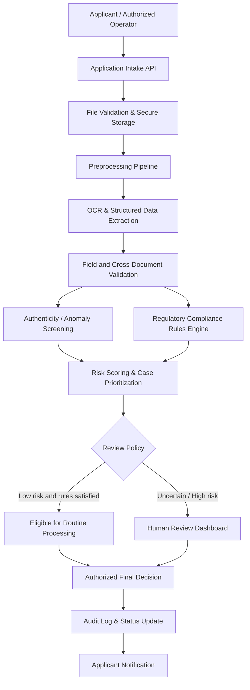

<div align="center">

# AI-Powered Application Validation & Document Compliance

### Smarter document checks • Automated eligibility screening • Humans make the final call

**SIH26261 · AICTE · Team QUANTUM CODERS**

</div>

---

## 🌍 Overview

Checking applications by hand is slow, tiring, and easy to get wrong. When officers have to go through piles of forms, certificates, ID documents, and supporting papers, things pile up, decisions become inconsistent, and forged or altered documents can slip through.

We're building an **AI-powered platform for application validation and regulatory compliance**. It brings together **OCR, document-forensics signals, rule-based compliance checks, anomaly detection, risk scoring, and human review** in a single workflow.

The system reads the documents people submit, pulls out the key details, checks that nothing is missing, spots inconsistencies, and tests the application against configurable eligibility rules. Anything uncertain or risky goes to an authorized officer. The goal is to **help decision-makers, not replace their final judgment**.

> **Our goal:** Cut down repetitive verification work, make decisions more consistent and traceable, and help applications get processed faster and more transparently.

**The problem we're tackling**

- **Heavy manual workload:** Officers keep re-checking the same forms and supporting documents.
- **Slow turnaround:** Missing fields, mismatched details, and endless follow-ups hold applications up.
- **Fraud and tampering:** Altered, duplicated, expired, or inconsistent documents are hard to catch at scale.
- **Changing rules:** Eligibility and regulatory requirements vary by application type and change over time.
- **Weak traceability:** It's hard to explain afterward why a case was flagged or approved.

---

## 🚀 Key Features

| Feature | How it works | What you get |
|---|---|---|
| Document ingestion | File validation, MIME/type checks, PDF and image handling | A consistent, reliable input pipeline |
| OCR-based extraction | OCR engine, image preprocessing, field normalization | Searchable, structured data from documents |
| Application validation | Schema validation, required-field checks, format rules | Incomplete submissions caught early |
| Cross-document consistency | Entity and field matching with deterministic comparison rules | Mismatched names, dates, IDs, and values flagged |
| Authenticity screening | Image and metadata checks, anomaly indicators | Suspicious documents surfaced for review |
| Compliance rules engine | Versioned, configurable business rules | Consistent eligibility checks |
| Risk scoring | Weighted signals and explainable rules | The cases that need attention come first |
| Human-in-the-loop review | Officer dashboard, review queues, override with reasons | Important decisions stay with people |
| Auditability | Timestamped events, decision reasons, reviewer actions | Clear traceability and accountability |
| Status notifications | Event-driven status updates | Applicants stay in the loop |

*Authenticity screening and risk scores are there to support decisions. They don't prove fraud on their own.*

---

## 🛠️ Software Stack

The technology we plan to use for the prototype:

| Layer | Technology | What it's for |
|---|---|---|
| Frontend | React + TypeScript | Applicant interface and officer dashboard |
| UI styling | Tailwind CSS or a component library | Responsive, reusable UI |
| Backend API | Python + FastAPI | REST endpoints, request validation, orchestration |
| OCR | Tesseract OCR or EasyOCR | Reading text from scanned documents |
| Image processing | OpenCV + Pillow | Deskewing, denoising, thresholding, normalization |
| Data validation | Pydantic + JSON Schema | Typed payloads and schema validation |
| AI/ML | scikit-learn; optional PyTorch | Anomaly detection or classification experiments |
| Rules engine | Versioned Python rules module or a dedicated engine | Configurable eligibility and compliance checks |
| Database | PostgreSQL | Applications, rule outcomes, review states, audit metadata |
| File storage | Private object storage (protected local storage in dev) | Storing uploaded documents |
| Background jobs | Celery/RQ + Redis (if async is needed) | OCR and other long-running tasks |
| Authentication | OAuth 2.0 / OpenID Connect | Identity and role-based access |
| Testing | pytest + HTTPX | Unit, integration, and API tests |
| Deployment | Docker; CI/CD pipeline | Reproducible builds and controlled releases |
| Observability | Structured logs and metrics | Troubleshooting and monitoring |

---

## ⚙️ Hardware Components

This is a **software-first project with no custom hardware**. It runs on standard infrastructure:

| Component | Role |
|---|---|
| Application server(s) | Run the FastAPI backend and web frontend |
| Worker node(s) | Handle OCR and image processing; a GPU is optional and only useful if we add heavier ML models |
| Database server | PostgreSQL for application records and audit data |
| Secure object storage | Private storage for uploaded documents |
| Document capture devices | Phones, scanners, or cameras applicants use to upload documents |
| Officer workstations | Browsers used for the review dashboard |

---

## 🧩 Software Modules

| Module | What it does |
|---|---|
| Intake API | Receives applications and files, creates case IDs |
| File validation & storage | Checks file types and sizes, stores files securely |
| Preprocessing | Normalizes PDFs and images, deskews, denoises |
| OCR & extraction | Turns document content into structured fields with confidence scores |
| Validation engine | Runs required-field, format, and cross-document checks |
| Authenticity / anomaly screening | Flags suspicious visual or metadata patterns |
| Compliance rules engine | Applies versioned eligibility and regulatory rules |
| Risk scoring & triage | Combines signals into an explainable review priority |
| Officer review dashboard | Review queues, evidence view, overrides with reasons |
| Audit logging | Keeps an append-only history of every action |
| Notification service | Sends status updates to applicants |

**Core concepts:** OCR, document normalization, entity resolution, rule-based validation, anomaly detection, risk-based triage, human-in-the-loop review, audit logging.

**Example risk-triage signals** (illustrative only, not a validated fraud detector):

| Signal | Example | What happens |
|---|---|---|
| Missing required field | A mandatory value is absent | Sent back for completion or review |
| Cross-document mismatch | Name or date differs between documents | Flagged for officer review |
| Low OCR confidence | Extracted text is uncertain | Ask for a clearer file or check manually |
| Suspected alteration | Unusual image or metadata pattern | Escalated for extra verification |
| Compliance rule failure | An eligibility condition isn't met | Show the exact rule and evidence |
| Duplicate candidate | A similar application or document already exists | Compare records before acting |

**Important:** A single score should never be the only reason to reject an application. Always show the reasons, keep the evidence, and let an authorized person review and correct the outcome.

---

## 🧪 Prototype Workflow



| Stage | Input | Processing | Output |
|---|---|---|---|
| 1. Intake | Form and uploaded files | File checks, case ID creation | Registered application |
| 2. Extraction | PDF/image documents | OCR, preprocessing, normalization | Structured fields with confidence |
| 3. Validation | Extracted fields | Required-field, format, and consistency checks | Validation findings |
| 4. Verification | Documents and extracted data | Authenticity and anomaly checks | Review signals |
| 5. Compliance | Application attributes | Versioned eligibility rules | Rule results and reasons |
| 6. Triage | Findings and rule results | Risk-based prioritization | Review priority |
| 7. Decision | Case summary and evidence | Authorized officer review | Recorded decision |
| 8. Audit | Events and reviewer actions | Append-only event logging | Traceable case history |

---

## 🧮 Power Optimization Strategies

Because this is a software-only system, "power optimization" for us means **using compute and energy wisely**:

- **Tiered processing:** Run the cheap checks first (file type, required fields, formats) and skip heavy OCR/ML on files that already fail.
- **Smart image handling:** Downscale and crop to text regions before OCR to save CPU time.
- **Asynchronous job queue:** Process OCR in batches on workers (Celery/RQ + Redis) so resources grow and shrink with demand.
- **Lightweight models first:** Start with classical ML (scikit-learn) and Tesseract, and save GPUs/PyTorch for cases that truly need them.
- **Caching:** Cache OCR output and rule results by file hash so duplicates aren't processed twice.
- **Selective human review:** Only uncertain or high-risk cases reach officers, which saves their time too.
- **Autoscaling and right-sized containers:** Scale workers down when things are quiet.

---

## 📅 Hackathon Development Plan

How we plan to build the prototype, phase by phase:

| Phase | Focus | What we'll deliver |
|---|---|---|
| 1. Foundation | Repo setup, FastAPI skeleton, upload API, file validation | A working intake endpoint |
| 2. Extraction | Preprocessing, OCR, field normalization | Structured fields from sample documents |
| 3. Validation & rules | Required-field checks, cross-document matching, versioned rules | Validation and compliance results with reasons |
| 4. Risk & review | Explainable risk triage, officer dashboard | Review queue and decision capture |
| 5. Audit & polish | Audit logging, notifications, tests, demo data | An end-to-end demo |
| 6. Presentation | Evaluation on test data, slides, demo video | Final submission |

**Project status**

- [ ] Application intake and upload validation
- [ ] OCR preprocessing and field extraction
- [ ] Required-field and cross-document validation
- [ ] Configurable compliance rules
- [ ] Explainable risk triage
- [ ] Officer review dashboard
- [ ] Audit logging and status updates
- [ ] Automated tests and evaluation report
- [ ] Deployment and security review

*We only tick a task once it's actually built and tested.*

**Security & responsible AI:** We follow least-privilege access, use TLS and encrypted storage, keep uploads in private storage with size and type limits, avoid logging raw identity documents, set retention and deletion policies, version our rules, record every reviewer override, monitor false positives and negatives, and never call a document fraudulent just because an algorithm flagged it.

---

## 📊 Results & Impact

**Results:** The prototype is still in development, so **we haven't reported any measured results yet**. We'll publish performance numbers only after running reproducible experiments on labeled, permissioned data (or on clearly marked synthetic data).

**How we'll evaluate it**

| Metric | What it tells us |
|---|---|
| OCR field accuracy | How correct the extracted fields are compared with ground truth |
| Precision / Recall / F1 | How well any fraud/anomaly classification works |
| False-positive rate | How often legitimate documents get wrongly flagged |
| Validation coverage | Share of required rules tested successfully |
| Processing latency | Time from upload to first validation results |
| Human review time | How long reviewers take to resolve a case |
| Throughput | Applications processed per unit of time |
| Audit completeness | Decisions that have the required events and rationale |

**Test scenarios:** clean scans; low-resolution, skewed, or noisy images; missing fields and malformed values; cross-document mismatches; expired or duplicate documents; controlled suspicious alterations; rule-version regression tests; unauthorized access and malformed uploads.

**What we hope to achieve**

- Reduce repetitive manual checks through automation.
- Catch incomplete or inconsistent applications earlier.
- Direct closer human attention to the cases that need it.
- Make decisions more consistent with versioned, configurable rules.
- Support traceable decisions through audit events and recorded reasons.
- Build a foundation that can grow to more application types and departments.

---

## 🧭 Competitor Landscape

Existing solutions fall into a few groups:

| Category | Examples | Typical focus | How we're different |
|---|---|---|---|
| Identity verification platforms | Onfido, Veriff, Jumio, IDfy, Signzy, HyperVerge | ID document and selfie/KYC checks for businesses | We focus on regulatory application workflows with configurable eligibility rules and officer review |
| Intelligent document processing | ABBYY, Tungsten Automation (Kofax), Docsumo | Data extraction and workflow automation | We add authenticity screening, risk triage, and compliance rules in one pipeline |
| Government credential systems | DigiLocker and similar digital-document ecosystems | Issuing and sharing verified digital documents | We complement them and can also handle documents not available in such systems |
| Manual verification / background-check services | Third-party credential verification agencies | Human-led checking | We automate the repetitive checks and keep people for the important decisions |

**What sets us apart:** versioned, configurable compliance rules; explainable (not black-box) risk scoring; humans making the final decision; and a full audit trail.

---

## 📁 Repository Structure

```text
.
├── frontend/                 # Applicant portal and officer dashboard
├── backend/
│   ├── api/                  # FastAPI routes and request schemas
│   ├── services/             # OCR, validation, compliance, risk triage
│   ├── models/               # Database and domain models
│   ├── rules/                # Versioned eligibility/compliance rules
│   └── audit/                # Audit event handling
├── tests/
│   ├── unit/
│   ├── integration/
│   └── fixtures/             # Synthetic or permissioned test files only
├── docs/                     # Architecture, API, and design notes
├── .env.example              # Placeholder configuration only
├── docker-compose.yml        # Optional local development setup
└── README.md
```

## ▶️ Getting Started

```bash
# 1. Clone the repository
git clone https://github.com/shivakalaiarasan2008-cpu/quantum-coders.git
cd quantum-coders

# 2. Create and activate a virtual environment
python -m venv .venv
# Windows PowerShell: .venv\Scripts\Activate.ps1
# macOS / Linux:      source .venv/bin/activate

# 3. Install dependencies
pip install -r requirements.txt

# 4. Copy .env.example to .env and fill in your local values

# 5. Start the API (adjust the module path to match the app)
uvicorn app.main:app --reload
```

Please never commit real secrets, API keys, personal documents, or production credentials.

## 📚 References

1. [Risks of Manual Credential Verification — Qualification Check](https://qualificationcheck.com/resources-news/risks-of-manual-credential-verification/)
2. [Intelligent Document Processing ROI — Tungsten Automation](https://www.tungstenautomation.com/blog/intelligent-document-processing-roi)
3. [A Framework for Online Document Verification Using Self-Sovereign Identity — *Sensors*](https://www.mdpi.com/1424-8220/22/21/8408)

*These sources are background reading. They don't measure how well this project performs.*

## 👥 Team

**QUANTUM CODERS**
**Smart India Hackathon Problem ID:** SIH26261
**Problem domain:** AI-powered application validation, document authentication, and regulatory compliance verification.

| Name | Role |
|---|---|
| Yasvanth Srinivasan S | Team Lead |
| Nithisree V | Pitch & Presentation |
| Meera M | Pitch & Presentation |
| Vikas K | Backend Developer |
| Shiva K | Full-Stack Developer |
| Sri Prakash KS | Vibe Coder |

---

<div align="center">

**Automate the repetitive checks. Surface the anomalies. Keep final decisions accountable.**

</div>
